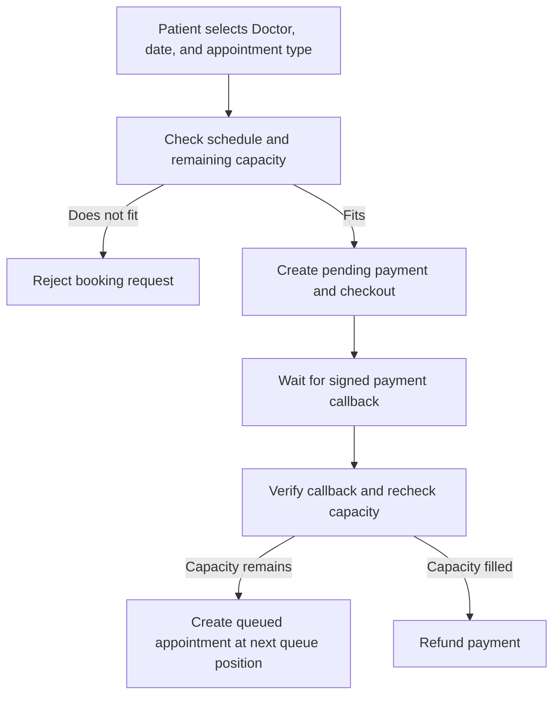

# HospitalCare

HospitalCare is a REST API for hospital appointment management.

## Stack

- .NET 10 and ASP.NET Core
- Entity Framework Core and SQL Server
- ASP.NET Core Identity and JWT bearer authentication
- MediatR for CQRS and FluentValidation for request validation

## Project layout

- `HospitalCare.Domain` contains the hospital entities and domain types.
- `HospitalCare.Application` contains use cases, validation, DTOs, and interfaces used by the application layer.
- `HospitalCare.Infrastructure` implements persistence, identity, and external service integrations.
- `HospitalCare.API` hosts the HTTP API and wires the application and infrastructure layers together.

## Requirements

- .NET 10 SDK
- SQL Server

## Configuration

The API reads the connection string from `ConnectionStrings:DefaultConnection`. The checked-in `appsettings.json` uses a local SQL Server instance named `.` and Windows integrated authentication. Set a user secret to use a different connection string:

```powershell
dotnet user-secrets set "ConnectionStrings:DefaultConnection" "YOUR_SQL_SERVER_CONNECTION_STRING" --project HospitalCare.API
```

The API also requires `Jwt:SecretKey`. Store a unique secret with at least 32 UTF-8 bytes in user secrets:

```powershell
dotnet user-secrets set "Jwt:SecretKey" "REPLACE_WITH_A_RANDOM_SECRET_OF_AT_LEAST_32_UTF8_BYTES" --project HospitalCare.API
```

Replace the example value before running the command. `Jwt:Issuer` and `Jwt:Audience` have development values in `HospitalCare.API/appsettings.json`. User secrets are stored outside the repository. Environment variables can also be used with the names `ConnectionStrings__DefaultConnection` and `Jwt__SecretKey`.

The payment provider is selected with `PaymentGateway:Provider`; the checked-in value uses the internal Fake provider. Store its webhook signing secret outside the repository:

```powershell
dotnet user-secrets set "PaymentGateway:Fake:WebhookSecret" "REPLACE_WITH_A_RANDOM_SECRET_OF_AT_LEAST_32_UTF8_BYTES" --project HospitalCare.API
```

The equivalent environment variable is `PaymentGateway__Fake__WebhookSecret`. The Fake provider returns a non-routable checkout URL and accepts signed test callbacks at `POST /api/payments/webhook`; it does not contact a payment service.

The webhook reads a raw UTF-8 JSON body with `gatewayReference`, `status` (`Succeeded` or `Failed`), `amount`, and `currency` (`EGP`). Send `X-Payment-Signature` as the hexadecimal HMAC-SHA256 of the exact request body using the configured secret. A successful callback creates the queued Appointment if capacity remains; otherwise the Fake refund completes locally.

To use Paymob, set `PaymentGateway:Provider` to `Paymob` and configure the keys, integration ID, and publicly reachable HTTPS notification URL from the Paymob dashboard. Keep every key and secret in user secrets or environment variables:

```powershell
dotnet user-secrets set "PaymentGateway:Provider" "Paymob" --project HospitalCare.API
dotnet user-secrets set "Paymob:SecretKey" "PAYMOB_SECRET_KEY" --project HospitalCare.API
dotnet user-secrets set "Paymob:PublicKey" "PAYMOB_PUBLIC_KEY" --project HospitalCare.API
dotnet user-secrets set "Paymob:HmacSecret" "PAYMOB_HMAC_SECRET" --project HospitalCare.API
dotnet user-secrets set "Paymob:IntegrationId" "PAYMOB_INTEGRATION_ID" --project HospitalCare.API
dotnet user-secrets set "Paymob:NotificationUrl" "https://YOUR_PUBLIC_HOST/api/payments/paymob/webhook" --project HospitalCare.API
dotnet user-secrets set "Paymob:Currency" "EGP" --project HospitalCare.API
dotnet user-secrets set "Paymob:RedirectUrl" "https://YOUR_FRONTEND_HOST/payment/complete" --project HospitalCare.API
```

`Paymob:BaseUrl` defaults to `https://accept.paymob.com` and can be set to the official regional origin for the merchant account. Set `Paymob:RedirectUrl` when a customer-facing completion URL is available. Paymob checkout creates an Intention and returns the Unified Checkout URL. Callbacks are correlated by signed `order.id`; the API verifies the documented transaction HMAC before processing them. A Paymob refund requires the provider transaction ID saved from a verified callback. The adapter has been verified by creating a test Intention with test credentials; no payment was completed.

Doctor schedules use local wall-clock time. Availability calculations use `Hospital:TimeZoneId`, which defaults to `Africa/Cairo`; the environment variable name is `Hospital__TimeZoneId`.

## Authentication

Login locks an account for 15 minutes after five failed password checks. The API allows ten login requests per minute per client IP; rejected requests return `429 Too Many Requests` as ProblemDetails.

## Database

On startup, `DbInitializer` applies pending Entity Framework migrations and seeds the `Admin`, `Doctor`, `Receptionist`, and `Patient` roles.

The first Admin account is seeded only when both `SeedAdmin:Email` and `SeedAdmin:Password` are configured. Store them in user secrets or environment variables:

```powershell
dotnet user-secrets set "SeedAdmin:Email" "admin@example.com" --project HospitalCare.API
dotnet user-secrets set "SeedAdmin:Password" "REPLACE_WITH_A_STRONG_PASSWORD" --project HospitalCare.API
```

When neither value is configured, startup skips Admin account seeding. If only one value is configured, startup fails. If the configured email already belongs to an account without the Admin role, startup also fails rather than changing that account's permissions.

The equivalent environment variable names are `SeedAdmin__Email` and `SeedAdmin__Password`.

To apply migrations manually:

```powershell
dotnet ef database update --project HospitalCare.Infrastructure --startup-project HospitalCare.API
```

To create a migration:

```powershell
dotnet ef migrations add MigrationName --project HospitalCare.Infrastructure --startup-project HospitalCare.API --output-dir Persistence/Migrations
```

## API endpoints

All routes are under `/api`. Requests that require authentication use a JWT bearer token. Role names are `Admin`, `Doctor`, `Receptionist`, and `Patient`.

| Endpoint | Access | Purpose |
|---|---|---|
| `POST /auth/register` | Anonymous | Register a Patient account and profile. |
| `POST /auth/login` | Anonymous | Authenticate and return a JWT. |
| `GET /departments` | Patient | List active Departments. |
| `POST /departments`, `PUT /departments/{id}`, `POST /departments/{id}/deactivate` | Admin | Create, rename, or gracefully deactivate a Department. |
| `GET /doctors`, `GET /doctors/{id}` | Admin, Patient | List or read Doctors; Patients see active Doctors. |
| `POST /doctors`, `POST /doctors/{id}/deactivate` | Admin | Create a Doctor account or gracefully deactivate a Doctor. |
| `GET /doctors/{id}/schedule` | Admin, Doctor, Patient | Read a schedule; Doctors can read their own, Patients active Doctors, and Admins any Doctor. |
| `GET /doctors/{id}/available-dates` | Patient | Get dates with capacity for an appointment type and inclusive date range. |
| `GET /doctors/{id}/queue` | Doctor, Receptionist | Read a paginated queue; Doctors can read their own queue. |
| `POST /doctors/me/queue/call-next` | Doctor | Call the next checked-in Patient in the Doctor's queue for today. |
| `POST /doctors/{id}/queue/call-next` | Receptionist | Call the next checked-in Patient for a Doctor today. |
| `PUT /doctors/me/schedule` | Doctor | Replace the current Doctor's weekly schedule. |
| `GET /appointment-types` | Admin, Patient | List appointment types and booking fees for browsing or booking. |
| `POST /appointment-types`, `PUT /appointment-types/{id}` | Admin | Create or update appointment types and booking fees. |
| `POST /receptionists` | Admin | Create a Receptionist account. |
| `POST /appointments/payments` | Patient | Start payment for an appointment booking. |
| `GET /appointments/me`, `GET /appointments/{id}` | Patient | Read the Patient's own appointments and queue rank. |
| `POST /appointments/{id}/cancel` | Patient, Receptionist, Admin | Cancel an eligible appointment; Patients can cancel only their own. |
| `POST /appointments/{id}/check-in` | Receptionist | Record a Patient's arrival. |
| `POST /appointments/{id}/start`, `POST /appointments/{id}/complete` | Doctor | Start or complete an appointment in the Doctor's own queue. |
| `GET /patients/me`, `PUT /patients/me`, `GET /patients/me/medical-history` | Patient | Read or update the Patient's own profile and medical history. |
| `GET /patients/{id}/medical-history` | Doctor, Receptionist | Read a Patient's history; Doctors need an appointment record with that Patient. |
| `POST /payments/webhook`, `POST /payments/paymob/webhook` | Anonymous, signed callback | Verify the internal Fake callback or Paymob transaction callback. |

## Booking and queue behavior



No queue position is reserved while payment is pending. Queue positions are not reused; a Patient's displayed position is their rank among queued and in-progress appointments.

```mermaid
stateDiagram-v2
    [*] --> Queued: payment confirmed
    Queued --> Queued: checked-in Patient called; five-minute window starts
    Queued --> Queued: first missed call with a next Patient; swap positions
    Queued --> InProgress: Doctor starts appointment
    Queued --> Cancelled: Patient, Receptionist, or Admin cancels
    InProgress --> Completed: Doctor completes appointment
    InProgress --> Cancelled: Patient, Receptionist, or Admin cancels
    Queued --> NoShowPenalized: second consecutive missed call
```

The first missed call remains queued and does not increment the skip count until there is a later queued Patient to swap with. A second consecutive missed call marks the appointment `NoShowPenalized`; its booking fee is retained. Queue estimates treat the day's schedule ranges as contiguous.

## Design decisions

- Doctor and Department deactivation stays pending while their queues drain; they accept no new bookings during that period.
- Receptionists check Patients in. A Doctor or Receptionist calling a checked-in Patient starts the five-minute no-show window.
- Schedule times are hospital-local wall-clock values. Timestamps are UTC; the hospital time zone defaults to `Africa/Cairo`.
- Capacity uses appointment duration and remaining schedule time. Completed, cancelled, and no-show-penalized appointments do not consume pending capacity.
- Appointment booking fees are stored on the appointment type in EGP. Paymob refund requests use the provider transaction ID and amount; the provider documents no remote idempotency key.
- Payment integration is behind `IPaymentGateway`. Fake remains the default; Paymob uses the documented Intention API, transaction HMAC, and refund endpoint.

Sample requests are in `HospitalCare.API/HospitalCare.API.http`. Replace its IDs and bearer tokens with values from the API responses. Use today's hospital-local date for queue actions and calculate the Fake webhook signature from the exact JSON body.

## Run

From the repository root:

```powershell
dotnet build HospitalCare.slnx
dotnet run --project HospitalCare.API --launch-profile http
```

The HTTP launch profile uses the Development environment and opens Swagger UI at `http://localhost:5074/swagger`.
