# HospitalCare

HospitalCare is a backend-only REST API for hospital departments, doctor schedules, patient appointments, payments, and doctor queues. It is built with ASP.NET Core on .NET 10 and organized around Clean Architecture with CQRS.



## Features

- Patient registration and login with ASP.NET Core Identity and JWT bearer authentication.
- Role-based access for **Admin**, **Doctor**, **Receptionist**, and **Patient**.
- Department, doctor, appointment-type, and doctor-schedule management.
- Appointment availability calculated from doctor schedules, appointment durations, and remaining daily capacity.
- Payment-first appointment booking: a confirmed payment callback creates the appointment and assigns its queue position.
- Patient appointment history, profile management, and medical-history access rules.
- Receptionist check-in and doctor/receptionist queue operations.
- No-show handling with a five-minute call window, queue swaps, and repeat no-show penalties.
- Payment gateway adapters for the local Fake provider and Paymob.
- EF Core migrations, role and appointment-type seeding, request validation, structured logging, and API rate limiting.

HospitalCare is an API project; it does not include a patient-facing web or mobile UI.

## Architecture

The solution contains four application projects and two test projects:

| Project | Responsibility |
|---|---|
| `HospitalCare.API` | HTTP controllers, authentication pipeline, OpenAPI, exception handling, and application startup. |
| `HospitalCare.Application` | MediatR commands and queries, handlers, validators, DTOs, interfaces, and pipeline behaviors. |
| `HospitalCare.Domain` | Hospital entities, enums, appointment state transitions, queue estimation, and capacity calculations. |
| `HospitalCare.Infrastructure` | EF Core/SQL Server, Identity, JWT creation, repositories, unit of work, payment gateways, and background processing. |
| `tests/HospitalCare.Application.Tests` | Domain rules, validators, capacity, and queue-estimation tests. |
| `tests/HospitalCare.API.Tests` | API, authentication, authorization, booking, payment, and queue integration tests. |

Application use cases depend on Domain. Infrastructure implements Application interfaces and uses Domain, while the API wires the layers together.

## Technology

- .NET 10 and ASP.NET Core Web API
- Entity Framework Core 10 and SQL Server
- ASP.NET Core Identity and JWT bearer authentication
- MediatR and FluentValidation
- Serilog
- OpenAPI and Swagger UI
- xUnit v3, `WebApplicationFactory`, and SQLite in-memory integration-test storage
- Docker Compose and GitHub Actions

## API overview

The API uses the `/api` route prefix. OpenAPI JSON and Swagger UI are available when the app runs in the Development environment.

| Area | Example endpoints | Access |
|---|---|---|
| Authentication | `POST /api/auth/register`, `POST /api/auth/login` | Public |
| Departments | `GET /api/departments` | Patient |
| Department administration | `POST /api/departments`, `PUT /api/departments/{id}`, `POST /api/departments/{id}/deactivate` | Admin |
| Doctors and schedules | `GET /api/doctors`, `GET /api/doctors/{id}/schedule`, `GET /api/doctors/{id}/available-dates`, `PUT /api/doctors/me/schedule` | Admin, Patient, or Doctor depending on the endpoint |
| Doctor queues | `GET /api/doctors/me/queue`, `GET /api/doctors/{id}/queue`, `POST /api/doctors/me/queue/call-next` | Doctor or Receptionist depending on the endpoint |
| Appointment types | `GET /api/appointment-types`, `POST /api/appointment-types`, `PUT /api/appointment-types/{id}` | Patient/Admin for reads; Admin for changes |
| Appointments | `POST /api/appointments/payments`, `GET /api/appointments/me`, `POST /api/appointments/{id}/check-in`, `POST /api/appointments/{id}/start`, `POST /api/appointments/{id}/complete` | Patient, Receptionist, or Doctor depending on the endpoint |
| Patient records | `GET /api/patients/me`, `PUT /api/patients/me`, `GET /api/patients/{id}/medical-history` | Patient, Doctor, or Receptionist according to the endpoint and access rules |
| Receptionist accounts | `POST /api/receptionists` | Admin |
| Payment callbacks | `POST /api/payments/webhook`, `POST /api/payments/paymob/webhook` | Public callback routes; signatures are validated by the configured gateway adapter |

For request and response schemas, use Swagger or the [Postman collection](docs/HospitalCare.postman_collection.json). See the controllers for the full route and authorization matrix.

## Booking and queue flow

1. A Patient chooses a Doctor, appointment type, and available date.
2. The API checks schedule capacity using the appointment type's duration.
3. `POST /api/appointments/payments` starts checkout. A queue position is not reserved while payment is pending.
4. A valid payment callback is checked and the appointment is created at the next queue position.
5. Reception checks in the Patient. A Doctor or Receptionist can call the next checked-in Patient.
6. If a called Patient does not check in within five minutes, the background processor applies the no-show rules. A first miss may swap queue positions when another queued Patient is available; a repeated miss is penalized.

Queue positions are not reused. Doctor and department deactivation can remain pending while their active queues drain.

## Requirements

- .NET 10 SDK for local development
- SQL Server, or Docker Desktop with Docker Compose
- A configured payment provider (`Fake` for local development or `Paymob` for a merchant integration)

## Run with Docker Compose

Copy the example environment file and set local values for the required database, JWT, and Fake-provider settings. Keep `.env` private and do not commit it.

```powershell
Copy-Item .env.example .env
```

Set `PAYMENT_GATEWAY_PROVIDER=Fake` for local development. The Compose configuration requires `MSSQL_SA_PASSWORD`, `JWT_SECRET`, `JWT_ISSUER`, `JWT_AUDIENCE`, and `FAKE_PAYMENT_WEBHOOK_SECRET`. Admin account seeding is optional; set both `SEED_ADMIN_EMAIL` and `SEED_ADMIN_PASSWORD` to enable it.

```powershell
docker compose up --build
```

The API is available at <http://localhost:8080>. Swagger UI is at <http://localhost:8080/swagger>. The API container waits for SQL Server health checks, then applies pending EF Core migrations and seeds roles and appointment types.

Stop the containers with:

```powershell
docker compose down
```

## Run locally

Configure `ConnectionStrings:DefaultConnection`, `Jwt:SecretKey`, `Jwt:Issuer`, `Jwt:Audience`, and `PaymentGateway:Provider` using .NET User Secrets or environment variables. Never commit real credentials. For the Fake provider, configure its webhook secret. To use Paymob, configure the `Paymob` section with the merchant credentials, integration ID, currency, and public callback URL.

Optional settings include `SeedAdmin:Email` and `SeedAdmin:Password` for the initial Admin account, `Hospital:TimeZoneId` (defaults to `Africa/Cairo`), and `Serilog:FilePath` (defaults to a daily rolling file under `logs/`). If either Admin seed value is supplied, both must be supplied.

Restore, run, and open the API:

```powershell
dotnet restore HospitalCare.slnx
dotnet run --project HospitalCare.API --launch-profile http
```

The `http` launch profile runs in Development at <http://localhost:5074>; Swagger UI is available at <http://localhost:5074/swagger>. The API applies pending database migrations during startup.

To manage migrations manually, use the Infrastructure project with the API as the startup project:

```powershell
dotnet ef database update --project HospitalCare.Infrastructure --startup-project HospitalCare.API
dotnet ef migrations add MigrationName --project HospitalCare.Infrastructure --startup-project HospitalCare.API --output-dir Persistence/Migrations
```

## Authentication and roles

Send the JWT returned by `POST /api/auth/login` as a bearer token for protected endpoints. The API uses the identity and role claims to resolve the current Patient or Doctor; profile operations use `/me` routes rather than accepting a client-selected profile ID.

| Role | Typical access |
|---|---|
| Admin | Manage departments, doctors, appointment types, and Receptionist accounts. |
| Doctor | Manage their schedule, view their queue, call the next Patient, and start or complete appointments. |
| Receptionist | Check in Patients and view/call queues for Doctors. |
| Patient | Browse active Doctors and appointment types, book and manage their own appointments, and access their own profile/history. |

The login endpoint has an IP-based rate limit, and protected endpoints enforce their configured role policies.

## Payments

Select the provider with `PaymentGateway:Provider`:

- **Fake** is intended for local/test flows. Its callback uses an HMAC signature over the raw request body.
- **Paymob** uses the Paymob intention, transaction callback, and refund operations. Configure merchant credentials and a publicly reachable HTTPS callback URL before using it outside local development.

The API validates provider callbacks before changing payment or appointment state. A browser redirect alone does not confirm payment.

## Tests and CI

Run the full test suite from the repository root:

```powershell
dotnet test HospitalCare.slnx
```

API integration tests use `WebApplicationFactory` and SQLite in-memory storage, so they do not require a separate SQL Server instance. The GitHub Actions workflow restores, builds, runs both test projects, uploads test results, and builds the Docker image without pushing it.

## Documentation

- [Arabic project guide](docs/project-guide-ar.md)
- [Business requirements](docs/business-requirements.md)
- [Design decisions](docs/design-decisions.md)
- [Postman collection](docs/HospitalCare.postman_collection.json)
- [Architecture diagram](docs/architecture/hospitalcare-architecture.svg)
- [Interactive architecture diagram source](docs/architecture/index.html)
- [Docker and CI notes](DOCKER_AND_CI.md)
