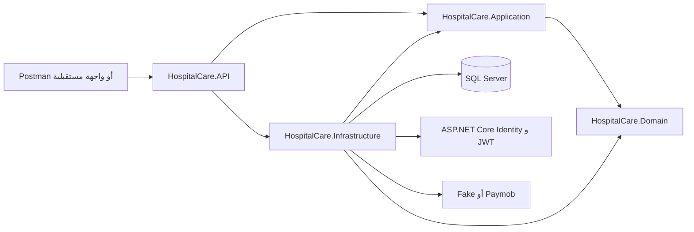
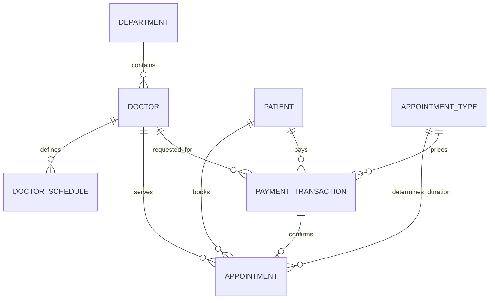
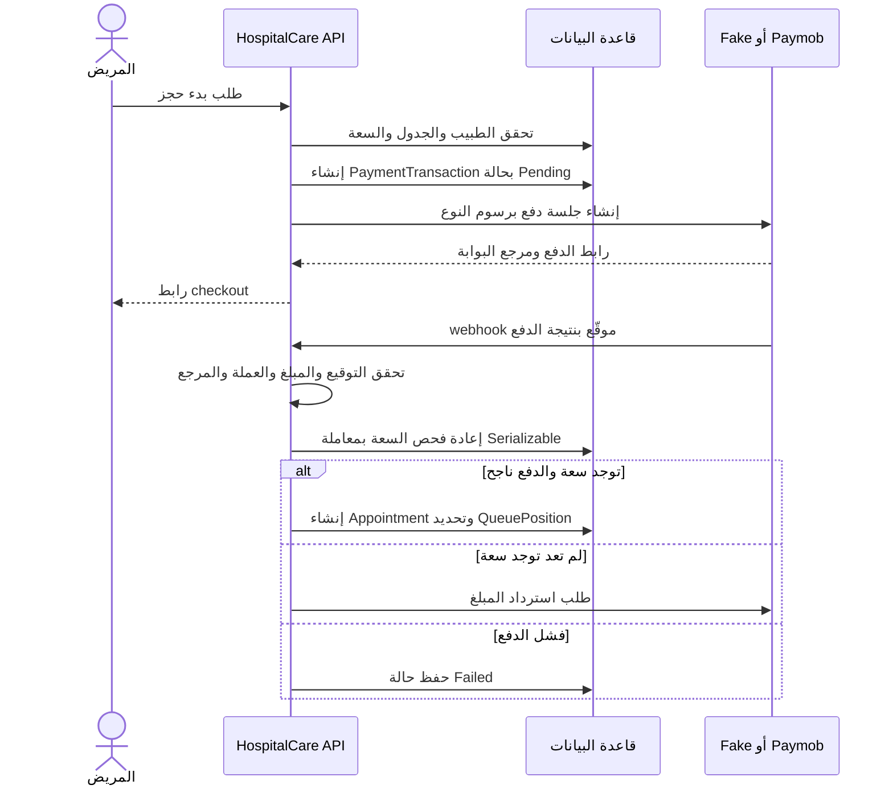
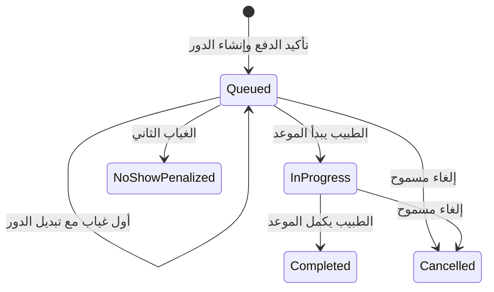

# دليل مشروع HospitalCare

## 1. لمن كُتب هذا الدليل؟

هذا الدليل يشرح المشروع لشخص يراه للمرة الأولى. يبدأ من فكرة النظام، ثم يشرح تقسيم الكود ومسار الطلبات وقواعد المستشفى، وينتهي بطريقة الإعداد والتشغيل والاختبار.

وثيقة `business-requirements.md` هي مرجع قواعد العمل المطلوبة. هذا الدليل يشرح تنفيذ الكود الموجود حاليًا، ويذكر بوضوح النقاط التي ما زالت تحتاج إعدادًا أو تجربة تشغيلية. إذا ظهر اختلاف بين شرح قديم وبين الكود، تُراجع الملفات المشار إليها في نهاية الدليل.

## 2. ما هو HospitalCare؟

HospitalCare هو REST API لإدارة مواعيد مستشفى متعدد الأقسام. لا يحدد الموعد بساعة ثابتة؛ بل ينشئ قائمة انتظار لكل طبيب ولكل يوم. يدفع المريض رسوم حجز قبل أن يدخل اسمه إلى القائمة، ثم يدير الطبيب أو موظف الاستقبال الحضور والدور.

تشمل الوظائف الأساسية:

- تسجيل حسابات المرضى وتسجيل الدخول.
- إدارة الأقسام والأطباء وأنواع المواعيد.
- حفظ جدول العمل الأسبوعي لكل طبيب وحساب الأيام التي ما زالت فيها سعة.
- بدء حجز مدفوع ثم تأكيده من إشعار بوابة الدفع.
- إدارة قائمة الانتظار والحضور والغياب والإلغاء.
- حفظ التاريخ الطبي للمريض والتحكم في من يستطيع قراءته.

المشروع Backend فقط: يوفّر API وSwagger، ولا يحتوي على واجهة مستخدم للمريض أو لوحة تشغيل للمستشفى.

## 3. كلمات ستتكرر في الشرح

| المصطلح | معناه في هذا المشروع |
|---|---|
| API | عناوين HTTP التي يتصل بها تطبيق الويب أو Postman لإرسال الطلبات واستقبال النتائج. |
| Domain | الكيانات وقواعد المستشفى التي يجب أن تظل صحيحة بغض النظر عن قاعدة البيانات أو طريقة الاتصال. |
| Use case | عملية واحدة يريد المستخدم تنفيذها، مثل إلغاء موعد أو تحديث جدول طبيب. |
| Command | طلب يغيّر بيانات النظام. |
| Query | طلب يقرأ بيانات ولا يغيّرها. |
| Handler | الكود الذي ينفذ Command أو Query. |
| DTO | شكل البيانات الذي يعيده الـ API أو يستقبله؛ يفصل عقد الـ API عن شكل جداول قاعدة البيانات. |
| JWT | رمز موقّع يرسله العميل بعد تسجيل الدخول لإثبات هوية المستخدم ودوره. |
| Migration | نسخة تغييرات قاعدة البيانات التي ينشئها EF Core ويطبقها على SQL Server. |
| Webhook | طلب HTTP ترسله بوابة الدفع إلى الخادم لإبلاغه بنتيجة الدفع. |

## 4. التقنيات المستخدمة

- **.NET 10 وASP.NET Core:** تشغيل التطبيق وبناء REST API.
- **Entity Framework Core وSQL Server:** تخزين البيانات وتعريف العلاقات والفهارس وترحيلات قاعدة البيانات.
- **ASP.NET Core Identity:** تخزين حسابات الدخول وكلمات المرور والأدوار.
- **JWT Bearer:** مصادقة طلبات الـ API بعد تسجيل الدخول.
- **MediatR:** توجيه Commands وQueries إلى handlers.
- **FluentValidation:** فحص مدخلات الأوامر والاستعلامات قبل تنفيذها.
- **Serilog:** تسجيل أحداث التطبيق والطلبات في الطرفية وملفات دورية.
- **xUnit:** اختبارات الوحدات واختبارات API.
- **SQLite in-memory في اختبارات API:** قاعدة بيانات مؤقتة للاختبارات، حتى لا تحتاج الاختبارات إلى SQL Server.

## 5. تقسيم الحل إلى مشاريع

الحل موجود في `HospitalCare.slnx`، ويتكون من أربعة مشاريع تشغيلية ومشروعين للاختبار.



الاتجاه المهم هو أن قواعد المستشفى لا تعتمد على تفاصيل الشبكة أو SQL Server. طبقة Infrastructure هي التي تنفذ واجهات Application وتتعامل مع الخدمات الخارجية.

### 5.1 `HospitalCare.Domain`

يحتوي على نماذج المجال وقواعدها، ولا يعتمد على المشاريع الأخرى. من أمثلته:

- الكيانات الموجودة في `Entities` مثل `Appointment` و`Doctor` و`Patient` و`PaymentTransaction`.
- الحالات في `Enums` مثل حالة الموعد وحالة الدفع.
- الحسابات الخالصة في `Services` مثل `DoctorCapacityCalculator` و`QueueEstimator`.
- الانتقالات الصحيحة لحالة الموعد: بدء، إكمال، إلغاء، وتسجيل الغياب.

مثلًا، `Appointment.Start` يرفض بدء موعد ليس في حالة Queued، و`Appointment.Complete` يرفض إكمال موعد لم يبدأ. بهذه الطريقة لا تعتمد صحة الانتقال على أن كل endpoint تذكر القاعدة بنفسها.

### 5.2 `HospitalCare.Application`

يحتوي على حالات الاستخدام. توجد أوامر واستعلامات وhandlers وvalidators وDTOs تحت `Features`، بينما توجد الواجهات والاستثناءات والسلوكيات المشتركة تحت `Common`.

أمثلة على الواجهات التي تحتاجها هذه الطبقة:

- `IUnitOfWork` و`IGenericRepository` لقراءة البيانات وحفظها دون ربط الحالة بـ EF Core مباشرة.
- `ICurrentUserService` لمعرفة هوية المستخدم وأدواره و`PatientId` أو `DoctorId` المأخوذة من JWT.
- `IPaymentGateway` لبدء الدفع والتحقق من webhook وإرسال طلب refund دون ربط حالات الاستخدام بمزود واحد.

كل عملية لها handler مستقل. الـ validators يرفضون المدخلات غير الصالحة، و`ValidationBehavior` يشغلها تلقائيًا عند إرسال الطلب عبر MediatR.

### 5.3 `HospitalCare.Infrastructure`

ينفذ تفاصيل التخزين والتكاملات:

- `Persistence` يحتوي `ApplicationDbContext` وتهيئة جداول EF Core وترحيلات قاعدة البيانات وتهيئتها الأولية.
- `Repositories` يحتوي المستودع العام، و`Persistence/UnitOfWork.cs` يجمع المستودعات والحفظ والمعاملات.
- `Identity` ينشئ حسابات المستخدمين ويربطها بملفات المرضى والأطباء ويقرأ هوية الطلب الحالي.
- `Authentication` ينشئ JWT.
- `Payments` يحتوي `FakePaymentGateway` و`PaymobPaymentGateway`.
- `BackgroundServices/NoShowProcessor.cs` يفحص المواعيد التي انتهت مهلة النداء لها.

عند القراءة، تستخدم الاستعلامات `AsNoTracking` عندما لا تحتاج إلى تعديل الكيانات. وعند تنفيذ تغيير مترابط، يحفظ `UnitOfWork` التغييرات في المعاملة المناسبة.

### 5.4 `HospitalCare.API`

هو حدّ HTTP الخاص بالنظام. يحتوي Controllers وعقود الطلبات الصغيرة وتهيئة التطبيق. الـ controller يقرأ المسار أو الطلب، ثم يرسل Command أو Query عبر `ISender` ويعيد النتيجة. لا يضع قواعد السعة أو الملكية أو الدفع داخله.

في `Program.cs` يتم تسجيل الخدمات، معالجة الأخطاء، التسجيل، المصادقة، تحديد المعدل، Swagger، ومسارات الـ controllers. في بيئة Development تتوفر Swagger UI.

### 5.5 مشاريع الاختبار

- `tests/HospitalCare.Application.Tests`: اختبارات قواعد المجال والتحقق والحسابات، مثل حساب السعة وتقدير الانتظار وانتقالات الموعد.
- `tests/HospitalCare.API.Tests`: اختبارات تكامل للـ API والمصادقة والصلاحيات ومسارات الحجز والطابور والدفع. تستخدم WebApplicationFactory وSQLite in-memory.

## 6. كيف يعبر الطلب داخل النظام؟

مثال `POST /api/appointments/{id}/cancel`:

1. يطابق ASP.NET Core الطلب مع `AppointmentsController` ويتحقق من JWT والدور المطلوب.
2. يبني الـ controller `CancelAppointmentCommand` ويرسله عبر `ISender`.
3. يمر الأمر على `LoggingBehavior` و`ValidationBehavior`.
4. ينفذ `CancelAppointmentCommandHandler` قواعد الصلاحية والملكية وحالة الموعد.
5. يقرأ الـ handler ويغيّر البيانات عبر `IUnitOfWork`، ويتعامل مع `IPaymentGateway` عند الحاجة إلى refund.
6. يعيد DTO إلى controller، ثم يحوله ASP.NET Core إلى JSON.

القاعدة العامة: الـ command يغيّر الحالة، والـ query يقرأها. الـ handler هو مكان تنسيق حالة الاستخدام، وقواعد الحالة الأساسية تبقى في Domain.

## 7. البيانات والعلاقات



حسابات Identity منفصلة عن الملفات الطبية. `Patient.UserId` يربط المريض بحساب الدخول، و`Doctor.UserId` يربط الطبيب بحسابه. موظف الاستقبال حساب Identity بدور Receptionist ولا يحتاج إلى كيان طبي مستقل. الـ Admin كذلك حساب ودور، وليس جدولًا خاصًا في المجال.

### أهم الحقول

- **Department:** اسم القسم، وهل هو نشط أو ينتظر إيقافه.
- **Doctor:** الاسم والقسم وحالة التفعيل وحالة انتظار الإيقاف وربط حساب Identity.
- **DoctorSchedule:** يوم الأسبوع وبداية ونهاية كل فترة عمل. يمكن للطبيب أن يحدد أكثر من فترة في اليوم.
- **Patient:** الاسم والبريد والهاتف وتاريخ الميلاد والحساسية والأمراض المزمنة.
- **AppointmentType:** اسم الموعد ومدته ورسوم الحجز.
- **PaymentTransaction:** صاحب الطلب والطبيب والنوع والتاريخ والمبلغ وحالة الدفع ومراجع المزود.
- **Appointment:** الطبيب والمريض والنوع والتاريخ ورقم الدور والحالة وأوقات البدء والإكمال والحضور والنداء.

تُخزن المبالغ بدقة `decimal(18,2)`، وعملة الدفع في النظام هي EGP. تاريخ الموعد من نوع تاريخ فقط، لأنه موعد قائمة انتظار وليس فترة زمنية محجوزة لمريض بعينه.

## 8. الهوية والصلاحيات وحماية البيانات

الأدوار في `Application/Common/Constants/Roles.cs` هي `Admin` و`Doctor` و`Receptionist` و`Patient`.

بعد تسجيل الدخول، يعيد النظام JWT يحتوي معرّف حساب Identity والبريد والدور. يتضمن الرمز أيضًا `patientId` للمريض أو `doctorId` للطبيب عند وجود ملف مرتبط. يقرأ `CurrentUserService` هذه القيم من claims.

الإجراءات التي تخص المستخدم نفسه لا تأخذ معرّف المريض أو الطبيب من جسم الطلب. مثلًا، إنشاء موعد يحدد المريض من JWT، والطبيب يقرأ طابوره وجدوله باستخدام مسارات `/me`. هذا يقلل احتمال أن يطلب مستخدم الوصول إلى بيانات شخص آخر بتغيير رقم في الطلب.

الملكية تُفحص داخل handler أيضًا، لأن وجود الدور وحده لا يثبت أن الموعد يخص المريض. الطبيب لا يقرأ التاريخ الطبي إلا إذا كان لديه موعد مسجل مع المريض. موظف الاستقبال يستطيع قراءة التاريخ الطبي بحسب الصلاحية المعرفة حاليًا.

ضوابط إضافية:

- يتطلب مفتاح JWT ما لا يقل عن 32 بايت UTF-8.
- تنتهي صلاحية JWT بعد 30 دقيقة حسب إعدادات المشروع الحالية.
- تُقفل محاولة الدخول للحساب 15 دقيقة بعد خمس كلمات مرور خاطئة.
- توجد حدود لعشر محاولات login في الدقيقة الواحدة لكل عنوان IP؛ الطلب الزائد يعيد 429 بصيغة ProblemDetails.
- لا تضع كلمات المرور أو مفاتيح Paymob أو JWT أو بيانات طبية في المستودع أو سجلات التشغيل.

## 9. شرح وظائف النظام

### 9.1 التسجيل وتسجيل الدخول

التسجيل المتاح ذاتيًا هو تسجيل مريض. ينشئ `RegisterPatientCommandHandler` حساب Identity وملف Patient ويربطهما. لا يختار العميل الدور بنفسه؛ النظام يضع دور Patient.

يسجل المستخدم الدخول بالبريد وكلمة المرور عبر `LoginCommand`. يتحقق Identity من بيانات الحساب، ثم ينشئ `JwtTokenService` الرمز. يرسل العميل الرمز في كل طلب محمي داخل الترويسة:

```http
Authorization: Bearer <JWT>
```

الأطباء وموظفو الاستقبال ينشئ حساباتهم Admin؛ لا يوجد تسجيل ذاتي لهذين الدورين.

### 9.2 الأقسام والأطباء وموظفو الاستقبال

- المريض يتصفح الأقسام النشطة فقط.
- Admin ينشئ الأقسام ويغير اسمها ويطلب إيقافها.
- Admin ينشئ حساب طبيب ودور Doctor وملف Doctor مرتبطًا بالقسم.
- المريض يتصفح الأطباء النشطين، ويمكنه التصفية بالقسم. يستطيع Admin عرض الأطباء غير النشطين أيضًا.
- Admin ينشئ حساب Receptionist ودوره.
- الطبيب غير النشط لا يظهر للمريض ولا يقبل حجزًا جديدًا.

### 9.3 أنواع المواعيد ورسوم الحجز

نوع الموعد يحدد مدته؛ المريض لا يرسل مدة حرة. عند تشغيل قاعدة البيانات لأول مرة، يضيف النظام نوعين افتراضيين إن لم يكونا موجودين:

| النوع | المدة | رسم الحجز الافتراضي |
|---|---:|---:|
| Consultation | 30 دقيقة | 100 EGP |
| Follow-up | 15 دقيقة | 50 EGP |

الرسوم قيم ابتدائية للعينة ويمكن لـ Admin تحديث الاسم والمدة والرسم من endpoints أنواع المواعيد.

### 9.4 جدول الطبيب والأيام المتاحة

الطبيب يستبدل جدوله الأسبوعي من `/api/doctors/me/schedule`. كل فترة لها يوم بداية ونهاية. يجب أن تكون النهاية بعد البداية وألا تتداخل فترتان في اليوم نفسه. إرسال مجموعة فارغة يمسح الجدول الأسبوعي.

الأوقات في الجدول تمثل ساعة المستشفى المحلية. المنطقة الزمنية الافتراضية `Africa/Cairo` وتُضبط عبر `Hospital:TimeZoneId`؛ أما timestamps مثل وقت بدء الموعد فتُخزن UTC. يعتمد النظام على `TimeProvider` للحصول على الوقت بدل قراءة ساعة النظام مباشرة في منطق الحالات.

حساب السعة يتم في `DoctorCapacityCalculator` دون اتصال بقاعدة البيانات:

```text
الدقائق المتاحة = مجموع دقائق فترات الجدول لهذا اليوم
الدقائق المتبقية اليوم = الجزء الذي لم ينته من الفترات فقط
الدقائق المحجوزة = مدد المواعيد بحالتي Queued أو InProgress
يُقبل النوع إذا كانت المحجوزة + مدة النوع <= المتاحة
```

المواعيد المكتملة أو الملغاة أو المعاقب عليها بسبب الغياب لا تستهلك السعة الجديدة. الاستعلام عن الأيام المتاحة يأخذ نوع الموعد لأن المدة تؤثر في القرار، ويقبل مدى شاملًا بحد أقصى 90 يومًا. اليوم الماضي أو اليوم الذي لا يوجد به جدول لا يقدم سعة.

### 9.5 حجز موعد والدفع

الحجز يمر بمرحلتين حتى لا يدخل مريض إلى الطابور قبل تأكيد الدفع:



خطوات التنفيذ:

1. يبدأ المريض `POST /api/appointments/payments` ويرسل الطبيب والتاريخ ونوع الموعد. هوية المريض تأتي من JWT.
2. يتحقق handler من القسم والطبيب ونوع الموعد والجدول والسعة. الطبيب أو القسم المعلّق إيقافه لا يقبل حجزًا جديدًا.
3. ينشئ النظام `PaymentTransaction` بحالة Pending وبقيمة `BookingFee` الخاصة بنوع الموعد.
4. يطلب handler من `IPaymentGateway` جلسة checkout ويرجع عنوانها للعميل. لا يحجز النظام رقم دور في هذه المرحلة.
5. بعد عودة المستخدم من بوابة الدفع، يرسل المزود webhook إلى `/api/payments/paymob/webhook` أو يستعمل الاختبار الداخلي `/api/payments/webhook`.
6. يتحقق النظام من التوقيع ومن أن المرجع والمبلغ والعملة تطابق السجل. ثم يعيد فحص السعة داخل معاملة Serializable؛ فحص البداية وحده لا يكفي لأن مريضًا آخر قد يدفع في الأثناء.
7. عند الدفع الناجح والسعة المتاحة، تُنشأ Appointment ويُعطى الدور التالي بعد أعلى رقم مستخدم لذلك الطبيب واليوم، حتى لو كان الرقم الأعلى تابعًا لموعد ملغى.
8. إذا نجح الدفع لكن انتهت السعة، يحفظ النظام `RefundPending` ويرسل طلب استرداد بدل إنشاء موعد.

تستخدم المعاملة Serializable مع فهرس فريد على الطبيب والتاريخ ورقم الدور، ويعيد `UnitOfWork` المحاولة عند deadlock أو تعارض الفهرس حتى ثلاث مرات. هذا يحمي تخصيص الأدوار عند وصول عمليتي تأكيد في الوقت نفسه.

### 9.6 مزود الدفع Fake وPaymob

`IPaymentGateway` هو الحد الفاصل بين حالات الاستخدام ومزود الدفع.

- **Fake:** هو الاختيار الافتراضي في `appsettings.json`. لا يتصل بخدمة مالية؛ يرجع رابطًا غير حقيقي ويقبل webhook داخليًا موقّعًا بـ HMAC-SHA256. Refund فيه لا ينفذ اتصالًا خارجيًا. يستخدم لتجربة بقية مسار الحجز.
- **Paymob:** ينشئ Intention عبر API، يعيد رابط Unified Checkout، ويتحقق من توقيع transaction callback ويرسل طلب refund. يحتاج مفاتيح Test أو Live وIntegration ID وإعدادات Paymob.

الـ Fake webhook يستخدم جسم JSON الخام كما وصل، وترويسة `X-Payment-Signature` التي تحتوي توقيع HMAC بالـ hex. لا تعدّل مسافات أو ترتيب الجسم عند حساب التوقيع في الاختبار؛ التوقيع مرتبط بالنص الدقيق.

لا يضمن `RefundPending` أن الاسترداد اكتمل لدى المزود؛ فهو سجل لمبلغ ينتظر تأكيد الاسترداد. لا يعيد النظام إرسال refund تلقائيًا عند webhook مكرر، لأن endpoint Paymob الموثق لا يوفر مفتاح idempotency. يجب مراجعة حالة العملية لدى Paymob قبل إعادة المحاولة يدويًا.

### 9.7 قائمة الانتظار والحضور والغياب

- موظف الاستقبال يسجل حضور المريض من `POST /api/appointments/{id}/check-in`.
- الطبيب أو موظف الاستقبال يستدعي المريض التالي الذي سجّل حضوره. هذا النداء يحدد بداية نافذة الخمس دقائق.
- الطبيب يبدأ الموعد من `/start` ثم يكمله من `/complete`، مع وقتي البدء والإكمال وملاحظات الاستشارة.
- استعلام الطابور paginated ويعرض التقدير ومدة التأخير. `QueueEstimator` يستخدم أوقات البدء والإكمال الفعلية لتحسين تقدير من يلي.
- خدمة `NoShowProcessor` تعمل كل 30 ثانية وتبحث عن نداء مضى عليه خمس دقائق من دون حضور.
- عند أول غياب، ينقل النظام المريض بعد المريض التالي ويبدل رقمي الدور؛ يظل الموعد في الطابور ولا تُفرض عليه غرامة. إذا لم يوجد مريض لاحق، يؤجل تسجيل الغياب الأول ولا يغير `SkipCount`.
- عند الغياب الثاني المتتالي، تتحول الحالة إلى `NoShowPenalized` ويُحتفظ برسم الحجز.

تبديل الأدوار يجري على مراحل داخل معاملة: ينقل موعد الغياب مؤقتًا إلى رقم أعلى من الأرقام الحالية، ثم يبدل الرقمين النهائيين. الرقم المؤقت يحافظ على الفهرس الفريد أثناء التبديل.

تبدأ تقديرات الانتظار من أول فترة في الجدول وتتعامل مع فترات اليوم كأنها متصلة؛ هذه تبسيط معلن في الحساب.

### 9.8 إلغاء الموعد والاسترداد

يمكن للمريض إلغاء موعده، ويمكن لموظف الاستقبال أو Admin إلغاء أي موعد. لا يحق للمريض إلغاء موعد مريض آخر. الحالات المسموح بإلغائها هي Queued وInProgress فقط.

إذا كانت الدفعة ناجحة، يحول النظام حالتها إلى `RefundPending` ضمن المعاملة، ثم يطلب رد كامل رسم الحجز من المزود. بعد نجاح طلب المزود تصبح الحالة `Refunded`. لا يتعامل مع الإلغاء كحذف للسجل؛ يحتفظ بالموعد وحالة الإلغاء في قاعدة البيانات.

### 9.9 إيقاف الطبيب أو القسم

إذا لم يكن للطبيب مواعيد Queued أو InProgress، يمكن إيقافه فورًا. إذا كانت لديه مواعيد مفتوحة، يضع النظام `PendingDeactivation` ويمنع حجوزات جديدة، لكنه يبقيه ظاهرًا حتى يفرغ الطابور. بعد إكمال أو إلغاء آخر موعد، تكمل خدمة `DoctorDeactivationService` الإيقاف.

إيقاف القسم يتبع القاعدة نفسها على مستوى كل أطبائه. إذا بقي لدى أي طبيب موعد مفتوح، يبقى القسم معلّقًا ولا يستقبل حجوزات. لا يؤدي طلب الإيقاف نفسه إلى إلغاء مواعيد أو استرداد رسومها.

### 9.10 الملف والتاريخ الطبي

المريض يقرأ ويعدل ملفه من `/api/patients/me`، ويدير الحساسية والأمراض المزمنة في حقول التاريخ الطبي. لا يقبل endpoint رقم Patient من العميل لإجراء التعديل الذاتي.

المريض يقرأ تاريخه بنفسه. موظف الاستقبال يستطيع قراءته ضمن دوره. الطبيب يجب أن يكون لديه موعد مسجل مع هذا المريض؛ handler يتحقق من ذلك قبل إرجاع التاريخ الطبي.

## 10. دورة حالات الموعد والدفع



تسميات الدفع هي `Pending` و`Succeeded` و`Failed` و`RefundPending` و`Refunded`. حالة `Pending` تعني أن طلب الدفع بدأ ولم يصل تأكيد نهائي. حالة `Succeeded` تعني أن المزود أكد الدفع؛ عندها فقط ينشأ الموعد. `RefundPending` تعني أن النظام طلب الاسترداد أو ينتظر حسمه.

## 11. واجهات الـ API

كل المسارات تبدأ بـ `/api`. المسارات المحمية تحتاج JWT، والمسارات الذاتية تستخدم `/me` لتوضيح أن الهوية تأتي من الرمز. القوائم التي قد تكبر تستخدم page number وpage size.

| الطريقة والمسار | الدور | ماذا يفعل؟ |
|---|---|---|
| `POST /auth/register` | عام | إنشاء حساب مريض. |
| `POST /auth/login` | عام | تسجيل الدخول وإرجاع JWT. |
| `GET /departments` | Patient | تصفح الأقسام النشطة. |
| `POST /departments` | Admin | إنشاء قسم. |
| `PUT /departments/{id}` | Admin | تغيير اسم قسم. |
| `POST /departments/{id}/deactivate` | Admin | طلب إيقاف القسم تدريجيًا. |
| `GET /doctors` | Admin, Patient | قائمة أطباء، ويمكن التصفية بالقسم. |
| `GET /doctors/{id}` | Admin, Patient | قراءة طبيب. |
| `POST /doctors` | Admin | إنشاء حساب وملف طبيب. |
| `POST /doctors/{id}/deactivate` | Admin | طلب إيقاف طبيب تدريجيًا. |
| `GET /doctors/{id}/schedule` | Admin, Patient | قراءة جدول طبيب. |
| `GET /doctors/me/schedule` | Doctor | قراءة جدول الطبيب الحالي. |
| `PUT /doctors/me/schedule` | Doctor | استبدال جدول الطبيب الحالي. |
| `GET /doctors/{id}/available-dates` | Patient | قراءة الأيام التي تتسع لنوع موعد ومدى تاريخي. |
| `GET /doctors/{id}/queue` | Receptionist | قراءة طابور طبيب لأي تاريخ. |
| `GET /doctors/me/queue` | Doctor | قراءة طابور الطبيب الحالي. |
| `POST /doctors/me/queue/call-next` | Doctor | نداء التالي في طابور اليوم. |
| `POST /doctors/{id}/queue/call-next` | Receptionist | نداء التالي لطبيب محدد. |
| `GET /appointment-types` | Admin, Patient | قائمة الأنواع والمدد والرسوم. |
| `POST /appointment-types` | Admin | إضافة نوع موعد. |
| `PUT /appointment-types/{id}` | Admin | تعديل نوع موعد. |
| `POST /receptionists` | Admin | إنشاء حساب موظف استقبال. |
| `POST /appointments/payments` | Patient | بدء الدفع لحجز موعد. |
| `GET /appointments/me` | Patient | قائمة مواعيد المريض مع الدور الحالي. |
| `GET /appointments/{id}` | Patient | قراءة موعد مملوك للمريض. |
| `POST /appointments/{id}/cancel` | Patient, Receptionist, Admin | إلغاء موعد مؤهل وطلب الاسترداد. |
| `POST /appointments/{id}/check-in` | Receptionist | تسجيل وصول المريض. |
| `POST /appointments/{id}/start` | Doctor | بدء موعد في طابور الطبيب نفسه. |
| `POST /appointments/{id}/complete` | Doctor | إكمال الموعد وتسجيل الملاحظات. |
| `GET /patients/me` | Patient | قراءة الملف الشخصي. |
| `PUT /patients/me` | Patient | تحديث الملف الشخصي. |
| `GET /patients/me/medical-history` | Patient | قراءة التاريخ الطبي الشخصي. |
| `GET /patients/{id}/medical-history` | Doctor, Receptionist | قراءة تاريخ طبي مع فحص الملكية للطبيب. |
| `POST /payments/webhook` | callback موقّع | استقبال webhook لمزود Fake. |
| `POST /payments/paymob/webhook` | callback موقّع | استقبال webhook من Paymob. |

تفاصيل الحقول والتحقق لكل endpoint موجودة في Commands وQueries وValidators تحت `HospitalCare.Application/Features`، بينما ملف Postman يحتوي طلبات تجربة عملية.

## 12. قاعدة البيانات وبدء التطبيق

`ApplicationDbContext` يرث من `IdentityDbContext` ويضم جداول Identity وجداول المجال. كل كيان له إعداد EF Core في `HospitalCare.Infrastructure/Persistence/Configurations`، وكل تغيير بنيوي محفوظ في `Persistence/Migrations`.

عند بدء التطبيق، ينفذ `DbInitializer` هذه الخطوات:

1. يطبق ترحيلات EF Core المعلقة.
2. يضيف أدوار Admin وDoctor وReceptionist وPatient إن لم تكن موجودة.
3. ينشئ Admin الأول عند ضبط البريد وكلمة المرور معًا.
4. يضيف Consultation وFollow-up إن لم يكونا موجودين.

لا يغير seeder صلاحية حساب موجود غير Admin. إذا تم ضبط بريد Admin دون كلمة مروره أو العكس، يفشل بدء التطبيق برسالة إعداد واضحة.

الفهارس المهمة تشمل عدم تكرار رقم الدور للطبيب والتاريخ، وعدم تكرار مرجع البوابة غير الفارغ. المعاملة والفهرس يعملان معًا لحماية التزامن.

## 13. إعداد البيئة وتشغيل المشروع

### المتطلبات

- .NET 10 SDK.
- SQL Server يعمل ويمكن الوصول إليه.
- مفاتيح سرية تُخزن في User Secrets أو متغيرات البيئة، لا في ملفات Git.

افتح PowerShell من جذر المستودع. ملف `global.json` يحدد نسخة SDK المطلوبة؛ استخدم نسخة .NET 10 متوافقة معه.

### إعداد connection string ومفتاح JWT

المشروع يستخدم `ConnectionStrings:DefaultConnection`. القيمة الموجودة في `appsettings.json` إعداد محلي لـ SQL Server باسم `.` مع Windows Authentication. استبدلها عند الحاجة:

```powershell
dotnet user-secrets set "ConnectionStrings:DefaultConnection" "YOUR_SQL_SERVER_CONNECTION_STRING" --project HospitalCare.API
dotnet user-secrets set "Jwt:SecretKey" "REPLACE_WITH_A_RANDOM_SECRET_AT_LEAST_32_UTF8_BYTES" --project HospitalCare.API
```

`Jwt:Issuer` و`Jwt:Audience` لهما قيم تطوير في `appsettings.json`. غيّر مفتاح JWT لمفتاح عشوائي خاص ببيئتك، ولا تستخدم قيمة المثال حرفيًا.

### تشغيل مزود Fake للتطوير

Fake هو مزود الدفع الافتراضي في إعدادات المستودع. لإرسال webhook اختباري، أضف سرًا محليًا لا يقل عن 32 بايت:

```powershell
dotnet user-secrets set "PaymentGateway:Provider" "Fake" --project HospitalCare.API
dotnet user-secrets set "PaymentGateway:Fake:WebhookSecret" "REPLACE_WITH_A_RANDOM_SECRET_AT_LEAST_32_UTF8_BYTES" --project HospitalCare.API
```

هذه الخدمة لا تخصم مالًا فعليًا ولا تتصل بـ Paymob. تفاصيل إنشاء التوقيع للـ Fake موجودة في README وPostman collection.

### تشغيل Paymob لاحقًا

لتفعيل Paymob، اضبط `PaymentGateway:Provider` على `Paymob` وضع القيم التي تخص البيئة نفسها (Test أو Live) في User Secrets:

```powershell
dotnet user-secrets set "PaymentGateway:Provider" "Paymob" --project HospitalCare.API
dotnet user-secrets set "Paymob:SecretKey" "PAYMOB_SECRET_KEY" --project HospitalCare.API
dotnet user-secrets set "Paymob:PublicKey" "PAYMOB_PUBLIC_KEY" --project HospitalCare.API
dotnet user-secrets set "Paymob:HmacSecret" "PAYMOB_HMAC_SECRET" --project HospitalCare.API
dotnet user-secrets set "Paymob:IntegrationId" "PAYMOB_INTEGRATION_ID" --project HospitalCare.API
dotnet user-secrets set "Paymob:NotificationUrl" "https://YOUR_PUBLIC_HOST/api/payments/paymob/webhook" --project HospitalCare.API
dotnet user-secrets set "Paymob:RedirectUrl" "https://YOUR_FRONTEND_HOST/payment/complete" --project HospitalCare.API
```

`Paymob:Currency` افتراضيًا EGP و`Paymob:BaseUrl` افتراضيًا `https://accept.paymob.com`. لا يمكن لـ Paymob إرسال webhook إلى عنوان محلي غير متاح من الإنترنت. يحتاج الاختبار الفعلي إلى عنوان HTTPS عام؛ أما الرابط الذي يرى العميل بعد checkout فيحتاج صفحة واجهة أمامية جاهزة. هذان الرابطان مؤجلان حاليًا حتى يعمل التطبيق وتتوفر عناوين مناسبة.

لا تضع أي قيمة سرية حقيقية في هذا الدليل أو README أو Postman collection أو صور ترسلها للآخرين.

### إنشاء Admin أول

اختياريًا، عيّن البريد وكلمة المرور معًا لحساب Admin الأول:

```powershell
dotnet user-secrets set "SeedAdmin:Email" "admin@example.com" --project HospitalCare.API
dotnet user-secrets set "SeedAdmin:Password" "REPLACE_WITH_A_STRONG_PASSWORD" --project HospitalCare.API
```

كلمة المرور تخضع لسياسات Identity. إذا لم تضبط القيمتين معًا، يتخطى التطبيق إنشاء حساب Admin؛ وإذا ضبطت واحدة فقط، يتوقف بدء التطبيق.

### Build وتشغيل الـ API

```powershell
dotnet restore HospitalCare.slnx
dotnet build HospitalCare.slnx
dotnet run --project HospitalCare.API --launch-profile http
```

بعد التشغيل، افتح `http://localhost:5074/swagger` في بيئة Development. من Swagger يمكنك استدعاء التسجيل والدخول ونسخ JWT ثم الضغط على زر Authorize وإدخال `Bearer <JWT>` للمسارات المحمية.

لتطبيق الترحيلات يدويًا أو إنشاء ترحيل جديد:

```powershell
dotnet ef database update --project HospitalCare.Infrastructure --startup-project HospitalCare.API
dotnet ef migrations add MigrationName --project HospitalCare.Infrastructure --startup-project HospitalCare.API --output-dir Persistence/Migrations
```

عادة يطبق `DbInitializer` الترحيلات تلقائيًا عند بدء التطبيق، لكن أمر `database update` مفيد لإدارة التغييرات يدويًا.

## 14. تجربة سيناريو باستخدام Postman

استورد `docs/HospitalCare.postman_collection.json` إلى Postman. يهيئ الطلبات بيانات القسم والطبيب والاستقبال والمريض والموعد في قاعدة البيانات التي يشير إليها التطبيق.

قبل التشغيل:

1. شغل API بإعداد Fake وconnection string لقاعدة تطوير.
2. أنشئ Admin من الإعدادات أو استخدم حساب Admin موجودًا.
3. أدخل كلمات المرور المطلوبة ومفتاح `fakeWebhookSecret` في متغيرات بيئة Postman المحلية، واجعل الحقول السرية مخفية.
4. تأكد أن مفتاح webhook في Postman يطابق `PaymentGateway:Fake:WebhookSecret`.
5. نفذ الطلبات بالترتيب المحفوظ في المجموعة؛ بعضها يعتمد على IDs التي ترجعها الطلبات السابقة.
6. عمليات الطابور تستخدم تاريخ المستشفى المحلي لليوم. إذا غُيرت المنطقة الزمنية في التطبيق، حدّث متغير Postman المقابل.

الـ collection مخصص للتطوير، وينشئ سجلات في قاعدة البيانات التي تضبطها؛ لا تستخدم قاعدة بيانات إنتاج عند تجربته.

## 15. تشغيل الاختبارات وفهمها

إذا كنت قد ضبطت `PaymentGateway:Provider` على Paymob في User Secrets، شغّل الاختبارات مع اختيار Fake مؤقتًا لهذه العملية. مصنع اختبارات API يعمل في Development ويقرأ إعدادات البيئة؛ إجبار Fake هنا يمنع الاختبارات من الاتصال بـ Paymob:

```powershell
$previousProvider = $env:PaymentGateway__Provider
$env:PaymentGateway__Provider = "Fake"
try {
    dotnet test HospitalCare.slnx
}
finally {
    if ($null -eq $previousProvider) {
        Remove-Item Env:PaymentGateway__Provider -ErrorAction SilentlyContinue
    }
    else {
        $env:PaymentGateway__Provider = $previousProvider
    }
}
```

في بيئة لا تحتوي إعداد Paymob محليًا، يكفي `dotnet test HospitalCare.slnx` لأن قيمة المستودع الافتراضية هي Fake.

تختبر مجموعة Application قواعد مثل:

- رفض انتقالات حالة الموعد غير الصحيحة.
- حساب السعة في المستقبل واليوم ومع تعدد الفترات.
- حساب تقديرات الطابور والتأخير.
- التحقق من مدخلات الأوامر والاستعلامات.

وتختبر مجموعة API أجزاء متكاملة من التطبيق، مثل التسجيل والدخول، الصلاحيات، استعلامات الطبيب والجدول والطابور، الحجز، callbacks، ومعالجة أخطاء API. تستخدم قاعدة SQLite مؤقتة بدل SQL Server.

اختبارات SQLite تثبت سلوك التطبيق داخل بيئة الاختبار، لكنها لا تثبت إعداد خادم SQL Server الفعلي أو إكمال دفع واسترداد حقيقيين لدى Paymob.

## 16. الأخطاء والسجلات

يتعامل `GlobalExceptionHandler` مع الاستثناءات من مكان واحد ويعيد `application/problem+json` وفق RFC 7807:

- 400 للأخطاء التجارية والمدخلات غير الصالحة.
- 401 لغياب المصادقة أو فشلها.
- 403 لعدم وجود صلاحية أو ملكية.
- 404 عندما لا يوجد السجل المطلوب.
- 409 عند تعارض الحالة أو العملية.
- 500 لخطأ غير متوقع برسالة عامة.

تعمل Serilog على الطرفية وملفات يومية تحت `logs/hospitalcare-.log` افتراضيًا، مع الاحتفاظ بحد أقصى 14 ملفًا. يمكن تغيير المسار عبر `Serilog:FilePath`. تجنب تسجيل كلمات المرور والتوكنات ومفاتيح الدفع أو تفاصيل التاريخ الطبي.

## 17. ما الذي لا يزال يحتاج إعدادًا أو تحققًا؟

- المشروع Backend API ولا يحتوي واجهة مريض أو واجهة موظف.
- روابط callback وredirect الحقيقية لـ Paymob مؤجلة حتى يتوفر عنوان API عام عبر HTTPS وصفحة نتيجة مناسبة.
- لا تعتبر تجربة إنشاء Paymob Intention إثباتًا لنجاح دفع أو refund حقيقي؛ يلزم تنفيذ سيناريو الاختبار الكامل في بيئة Paymob Test ثم مراجعة نتيجة المزود.
- رسوم Consultation وFollow-up قيم ابتدائية للتطوير، ويجب على Admin مراجعتها قبل استخدامها تشغيليًا.
- تقدير وقت الطابور يفترض أن فترات جدول اليوم متصلة.
- لا تعِد إرسال refund معلّق تلقائيًا بعد timeout؛ راجع حالة العملية لدى Paymob أولًا لتجنب refund مكرر.

## 18. أين تقرأ الكود عند تتبع وظيفة؟

| الوظيفة | ابدأ من |
|---|---|
| تشغيل التطبيق وتسجيل الخدمات | `HospitalCare.API/Program.cs` |
| تسجيل MediatR والـ validators | `HospitalCare.Application/DependencyInjection.cs` |
| تسجيل SQL Server وIdentity وJWT والـ gateways | `HospitalCare.Infrastructure/DependencyInjection.cs` |
| قواعد انتقال الموعد | `HospitalCare.Domain/Entities/Appointment.cs` |
| حساب أيام وسعة الطبيب | `HospitalCare.Domain/Services/DoctorCapacityCalculator.cs` |
| تقدير وقت قائمة الانتظار | `HospitalCare.Domain/Services/QueueEstimator.cs` |
| بدء دفع الحجز وتأكيده | `HospitalCare.Application/Features/Appointments/Commands` |
| واجهة الطلبات HTTP | `HospitalCare.API/Controllers` |
| استقبال callback | `HospitalCare.API/Controllers/PaymentsController.cs` و`HospitalCare.Infrastructure/Payments` |
| الجداول والترحيلات | `HospitalCare.Infrastructure/Persistence` |
| قواعد العمل المطلوبة | `docs/business-requirements.md` |
| قرارات التنفيذ المتفق عليها | `docs/design-decisions.md` |
| تجربة API من Postman | `docs/HospitalCare.postman_collection.json` |
